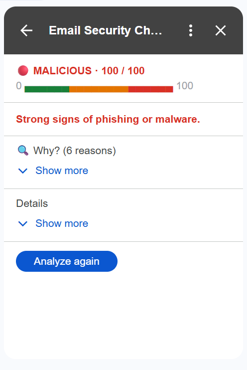
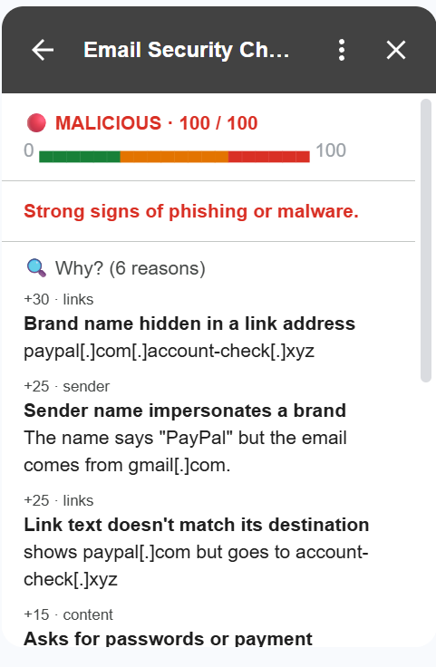
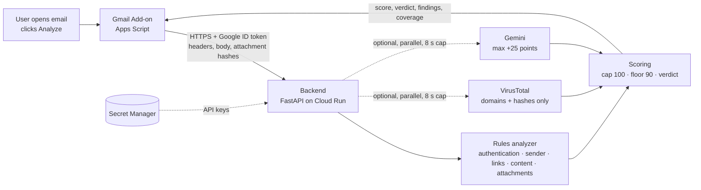

# Email Security Check — a Gmail add-on that scores malicious email

[](https://github.com/stavalg/gmail-email-scorer/actions/workflows/tests.yml)

Open an email in Gmail, click **Analyze**, and get a **0–100 maliciousness score**, a clear
verdict (**Safe / Suspicious / Malicious**) and the evidence behind it — every reason says
*what* was found and *why* it matters, so the user learns to spot the trick themselves.

<table>
  <tr>
    <td align="center"></td>
    <td align="center"></td>
  </tr>
  <tr>
    <td align="center"><sub>What the user sees: verdict, score bar, one-line summary</sub></td>
    <td align="center"><sub>One tap on <b>Why?</b>: every reason with its points and evidence</sub></td>
  </tr>
</table>

| | |
|---|---|
| **Add-on** | Google Apps Script + CardService (Gmail side panel) |
| **Backend** | Python 3.14 · FastAPI · Google Cloud Run |
| **Analysis** | 24 explainable rule signals · VirusTotal reputation · AI assessment (Gemini) |
| **Security** | Google identity-token auth (no shared secret) · least-privilege scopes · all input treated as hostile |
| **Quality** | 170 automated tests · locked dependencies · vulnerability scan in CI |

---

## Contents

1. [What it does](#1-what-it-does)
2. [Architecture](#2-architecture)
3. [How an email is scored](#3-how-an-email-is-scored)
4. [Security design](#4-security-design)
5. [Privacy](#5-privacy)
6. [Reliability: a failure never looks like "Safe"](#6-reliability-a-failure-never-looks-like-safe)
7. [Setup and deployment](#7-setup-and-deployment)
8. [Testing](#8-testing)
9. [Trade-offs and limitations](#9-trade-offs-and-limitations)
10. [Future work](#10-future-work)
11. [Decision log](#11-decision-log)

---

## 1. What it does

1. The user opens an email. The side panel offers **Analyze this email** — and says
   *"Nothing is sent until you click Analyze"*. Analysis is **on demand only**.
2. The add-on sends the minimum the backend needs (headers, body, attachment *metadata and
   fingerprints*) with a Google-signed identity token.
3. The backend analyzes it and returns a score, a verdict and the evidence.
4. The card shows, top to bottom:

| Part | Shown | Purpose |
|---|---|---|
| **Verdict + score bar** | always | e.g. `🔴 MALICIOUS · 100 / 100` with a green → orange → red bar filled to the score |
| **Summary** | always | one line in the verdict's color; warnings (e.g. *some checks did not complete*) are never hidden |
| **🔍 Why? (N reasons)** | tap to expand | each reason with its points and **defanged evidence** (`paypal[.]com[.]account-check[.]xyz`) |
| **Details** | tap to expand | analyst view: verified facts, which checks ran, sender domain, raw SPF/DKIM/DMARC, attachment hashes |

The card is deliberately clean for a normal user, while the full evidence is one tap away for
a security analyst.

## 2. Architecture



**Thin add-on, smart backend.** The add-on only collects data, calls the backend, and renders
the answer. All parsing and analysis lives in Python, because:

- Apps Script is hard to test; Python is easy to test (170 tests run on every push).
- API keys stay on the server, never in code that runs in the user's mailbox.
- New analyzers can be added without touching the add-on.

**Pluggable analyzers.** Every analyzer returns the same shape (`findings`, `facts`,
`notices`, `status`). The scorer only sees that shape, so analyzers can be added, removed or
fail without the scorer changing.

| Analyzer | Status | What it does |
|---|---|---|
| **Rules** | ✅ Built | 24 explainable signals, no network calls |
| **VirusTotal** | ✅ Built | Is an attachment fingerprint or link domain already known to be malicious? |
| **AI (Gemini)** | ✅ Built | How likely is this to be phishing, judged from the wording? Capped at +25 points |

### Code map

```
addon/                     Gmail add-on (Apps Script)
  Code.gs                  entry points: homepage, email opened, Analyze button
  Extract.gs               collects headers, body, attachment metadata + SHA-256
  Api.gs                   calls the backend with the identity token, validates the answer
  Cards.gs                 builds the cards; escapes every displayed string
backend/app/
  main.py                  HTTP layer: request size limit, safe errors, /v1/analyze, /health
  auth.py                  Google identity-token verification + email allowlist
  models.py                strict request/response schemas and size limits
  pipeline.py              parse once → run analyzers → score
  scoring.py               score, verdict, notices
  parsing/                 headers, body (text + links), domains — text only, never fetched
  analyzers/rules/         authentication, sender, links, content, attachments + runner
  analyzers/rules/data.py  every weight, brand and indicator list in one place
backend/tests/             170 tests (unit, API, edge cases)
backend/samples/           sample requests for curl
scripts/check_addon.js     offline checks of the add-on's pure functions
```

## 3. How an email is scored

Each signal that fires adds points. **Each signal counts once per email** (ten shortened links
do not add ten times), and the evidence says how many times it occurred.

| Category | Signal | Points |
|---|---|---|
| **Authentication** (Google's own verdict) | DMARC fail | +30 |
| | SPF fail / DKIM fail | +15 each (softfail: half) |
| **Sender** | Lookalike domain (`paypa1.com`, `rnicrosoft.com`) | +30 |
| | Display name contains a different email address | +30 |
| | Display name uses a brand phrase ("PayPal", "Chase Bank", "Apple Support") and the domain isn't that brand's | +25 |
| | Replies go to a different domain (Reply-To) | +15 |
| | Sender address can't be read | +10 |
| **Links** (read as text, never visited) | Brand hidden in someone else's domain (`paypal.com.evil.xyz`) | +30 |
| | Link text shows one domain, link goes to another | +25 |
| | Disguised characters (punycode, mixed alphabets) | +25 |
| | `javascript:` / `data:` link | +25 |
| | Link to a raw IP address | +20 |
| | URL shortener / frequently abused ending (`.xyz`, `.top`, …) | +10 each |
| **Content** (English) | Requests passwords or payment details | +15 |
| | Urgency or threats ("within 24 hours", "account suspended") | +10 |
| **Attachments** (name and type only) | Right-to-left filename trick (`invoice‮fdp.exe`) | +60 |
| | Double extension (`invoice.pdf.exe`) | +60 |
| | Executable or script (`.exe .js .vbs .ps1 .lnk .iso …`) | +40 |
| | HTML attachment (fake login pages) | +30 |
| | Archive + a password in the body (hides content from scanners) | +30 |
| | Macro-enabled Office file | +20 |
| | Archive | +15 |
| **Reputation** (VirusTotal) | Known malicious by ≥ 2 security vendors | +50, and score ≥ 90 |
| **AI** (Gemini) | Phishing likelihood ≥ 30 % (below: shown as a fact) | up to +25 |

**Score and verdict**

```
score = min(100, sum of points)
if VirusTotal confirms something malicious: score = max(score, 90)   # confirmed evidence beats guesses

0–29 Safe   ·   30–69 Suspicious   ·   70–100 Malicious
```

**Principle: nothing the attacker controls can lower the score.** A passing SPF/DKIM/DMARC check
is shown as a fact ("Sender verified: gmail.com") but never subtracts points — an attacker can
pass all three with a free Gmail account or a lookalike domain they own. These checks prove
*who* sent an email, not *whether to trust them*.

All weights live in [`data.py`](backend/app/analyzers/rules/data.py) and are validated at
startup (a negative or non-integer weight stops the app from starting).

## 4. Security design

### Who may call the backend

The backend URL is public, so every request must prove who it is:

- The add-on calls `ScriptApp.getIdentityToken()` and sends a **Google-signed identity token**.
- The backend verifies **signature, issuer, expiry and audience** (the add-on's own OAuth
  client ID), then checks `email_verified` and an **allowlist** of email addresses.
- **No shared secret exists anywhere**, so there is nothing to leak or rotate.
- Fails closed: if the audience is not configured, every request is refused (the library would
  otherwise skip the audience check).
- A local-only `DEV_SKIP_AUTH` switch exists for development; the app **refuses to start** with
  it on Cloud Run.

Verified live: no token → 401, forged token → 401, valid token for an email that is not on the
allowlist → 403 ("You're not authorized" card).

### Least privilege

The add-on requests only: read the **currently opened** message, run as a Gmail add-on, connect
to one external service (the fetch allowlist contains only our backend URL), and the user's
email address. No mailbox-wide read, no modify permissions.

### Every input is hostile

| Threat | Defense |
|---|---|
| Huge or malformed requests | Strict schemas (unknown fields rejected), size limits per field, 4 MB request cap checked before reading |
| Error messages leaking input | Validation errors return a generic `invalid_request` — the email is never echoed back |
| Visiting malicious links | Links are **never fetched**; they are parsed as text |
| Malicious attachments | **Contents never leave Gmail** — only name, type, size and SHA-256 |
| Malicious HTML / scripts | Parsed as data with Python's built-in parser; nothing rendered or executed. HTML the parser can't read falls back to the plain text (with a visible warning), and parsing runs off the server's event loop |
| **Forged authentication headers** | An attacker can write `Authentication-Results: … dmarc=pass` into their own email. Only the **topmost header whose authserv-id is exactly `mx.google.com`** is trusted, and it is read clause by clause with comments and quoted text removed — Google echoes the attacker-chosen envelope sender there |
| **Deceptive link syntax** | Hosts are resolved the way browsers do (WHATWG): `https://evil.xyz\@paypal.com` is analyzed as `evil.xyz`, not `paypal.com` |
| **Injection into our own card** | Subjects, file names and AI text are attacker-influenced; **every string is HTML-escaped** before display, so nothing becomes formatting or a link. Domains and URLs in rule evidence are also **defanged** (`hxxp://evil[.]com`) |
| Text-direction tricks | Invisible right-to-left characters are stripped before display |
| Padding attack | Links are extracted from the whole body *before* text is truncated, so 100 KB of filler can't hide a link |
| Hostile external answers | VirusTotal / AI answers are timed out, schema-validated and range-checked |
| AI prompt injection | Email passed as delimited data, strict JSON answer, **AI can only add up to +25** — it can never lower the score or decide alone |

### Secrets and supply chain

- API keys live in **Google Secret Manager** and reach Cloud Run as environment variables;
  never in code, Git or logs. `env.yaml` (allowlist, client ID) is git-ignored.
- The container runs as a **non-root user**; API documentation pages are disabled.
- **Every runtime package is pinned**, including indirect ones. `pip-audit` runs in CI on every
  push. (It caught 9 published vulnerabilities in `requests`/`starlette` during development —
  all upgraded.)
- Cloud Run is capped at **2 instances** and a **$1 budget alert** is set, so abuse can't create a bill.

## 5. Privacy

- **On demand:** nothing leaves Gmail until the user clicks Analyze.
- **Stateless:** the backend stores nothing; no database.
- **Logs contain no email data:** only verdict, score, duration and which checks ran. The HTTP
  client's request-URL logging is switched off so looked-up domains can't reach logs
  (regression-tested).
- **Data minimization to third parties:** VirusTotal receives **registrable domains and file
  hashes only** — never full links (they can contain private tokens, like password-reset links)
  and never files. The AI receives the subject and at most 4,000 characters of text.
- **Known trade-off:** Gemini's free tier may use submitted text to improve Google's products.
  Fine for a demo with test emails; production would use a paid tier with a no-training guarantee.

## 6. Reliability: a failure never looks like "Safe"

A security tool that crashes and shows a green "Safe" is worse than no tool.

- **Isolated checks:** each rule check runs on its own. If one crashes on a strange email, the
  others still run, coverage shows `partial`, and a Safe verdict gets the visible warning
  *"Some checks did not complete — treat 'Safe' with caution."*
- **Unreadable HTML** never stops the analysis: whatever was read is kept, the plain text is
  analyzed instead, coverage shows `partial`, and the card says so. (Python 3.12's HTML parser
  crashed on `<![<![` and took 28 s on 500 KB of `</`; the project pins Python 3.14.7, where both
  are fixed, and keeps the fallback anyway.)
- **Total failure** returns an error card with Retry — **never a score**.
- **Optional analyzers degrade gracefully:** VirusTotal and the AI run in parallel, each with a
  6 s network timeout and an 8 s hard cap (Gmail allows ~30 s; our budget is 15 s). Slow, down or rate-limited →
  the result still arrives, and coverage says what didn't run.
- **Truncation is always disclosed:** if an email was too large to analyze fully, the card says so.
- **The add-on validates the backend's answer** too, and shows an error rather than a malformed card.

## 7. Setup and deployment

### Prerequisites

- Python 3.14 (3.14.7 or newer — older versions have HTML-parser bugs), Node.js (for `clasp`), the [Google Cloud CLI](https://cloud.google.com/sdk/docs/install)
- `npm install -g @google/clasp@2.4.2`
- A Google Cloud project with billing enabled (stays in the free tier) and these APIs:
  ```bash
  gcloud services enable run.googleapis.com cloudbuild.googleapis.com artifactregistry.googleapis.com secretmanager.googleapis.com
  ```
- **OAuth consent screen** configured (External, Testing mode, your Gmail added as a test user)
- Apps Script API enabled at <https://script.google.com/home/usersettings>

### Run the backend locally

```bash
cd backend
python3.14 -m venv .venv
.venv/bin/pip install -r requirements-dev.txt        # Windows: .venv\Scripts\pip
.venv/bin/python -m pytest -q                         # 170 passed

DEV_SKIP_AUTH=true .venv/bin/python -m uvicorn app.main:app --port 8080
curl -s -X POST localhost:8080/v1/analyze -H "content-type: application/json" --data @samples/phishing.json
```

### Deploy the add-on (first time)

```bash
cd addon
clasp create --type standalone --title "Email Security Check" --rootDir .
clasp push --force
```

Then in the Apps Script editor (`clasp open`):
1. **Project Settings → Google Cloud Platform project →** paste your project **number**.
2. **Deploy → Test deployments → Install.**
3. Open any email in Gmail → open the add-on → **Analyze**. The first run shows the
   authorization screen.

### Deploy the backend

1. Copy `backend/env.example.yaml` to `backend/env.yaml` and fill in:
   - `ALLOWED_EMAILS` — your Gmail address
   - `OAUTH_CLIENT_ID` — the add-on's OAuth client ID: the `aud` claim of the token returned by
     `ScriptApp.getIdentityToken()` (decode the token's middle part once to read it; it is not a secret)
2. Deploy (works in bash and in Git Bash on Windows):
   ```bash
   cd backend && ./deploy.sh
   ```
   After the first deploy, keep old container images from piling up (stays in the free tier):
   ```bash
   gcloud artifacts repositories set-cleanup-policies cloud-run-source-deploy \
     --location=us-central1 --policy=cleanup-policy.json --no-dry-run
   ```
3. Put the printed `Service URL` into `addon/Config.gs` and into `urlFetchWhitelist` in
   `addon/appsscript.json` (with a trailing `/`), then `clasp push --force`.
4. Optional keys — each analyzer is skipped when its key is absent. Get a free
   [VirusTotal API key](https://www.virustotal.com) and a free
   [Gemini API key](https://aistudio.google.com) (create it in a project **without billing** to
   stay on the free tier), then store each one without it touching the screen or shell history:
   ```bash
   read -rs KEY && printf "%s" "$KEY" | gcloud secrets create virustotal-api-key --data-file=- && unset KEY
   read -rs KEY && printf "%s" "$KEY" | gcloud secrets create gemini-api-key --data-file=- && unset KEY
   SA="$(gcloud projects describe "$(gcloud config get-value project)" --format='value(projectNumber)')-compute@developer.gserviceaccount.com"
   for s in virustotal-api-key gemini-api-key; do
     gcloud secrets add-iam-policy-binding "$s" --member="serviceAccount:$SA" --role=roles/secretmanager.secretAccessor
   done
   ```
   `deploy.sh` already maps both secrets (`SECRETS=`); remove an entry there to disable that
   analyzer, then run `./deploy.sh` again.

> The health endpoint is `/health`, not `/healthz`: Cloud Run reserves paths ending in `z`.

## 8. Testing

```bash
cd backend && .venv/bin/python -m pytest -q      # 170 tests
node scripts/check_addon.js                        # add-on: escaping, answer validation, score bar
```

| Area | Tests | Examples |
|---|---|---|
| Authentication & config | 12 | missing / malformed / invalid token, user not on the allowlist, unverified email, fail-closed config, API keys stripped of pasted whitespace, clock-skew tolerance |
| Input validation | 8 | unknown fields rejected without echo, size limits, bad hashes, oversized request |
| Header parsing | 12 | **forged `Authentication-Results` below Google's**, **`dmarc=pass` hidden in Google's own header**, lookalike authserv-id, Hebrew RFC 2047 names |
| Body parsing | 15 | **link hidden after 100 KB of padding**, known pathological HTML (`</` × 250k, `<![`, `<!--`) in < 2 s, parser crash → plain-text fallback |
| Rules | 54 | `paypa1.com`, `pineapple.com` / "Chase Miller" are *not* brands, `user@host` and `\@` URL tricks, SPF-only never "verified", `invoice‮fdp.exe` |
| Scoring | 13 | cap at 100, boundaries 29/30/69/70, VirusTotal floor, caution notice |
| VirusTotal | 6 | known-malicious floor, **only domains/hashes sent (never full URLs)**, unknown items, rate limit, malformed answers |
| AI | 17 | strict-JSON parsing, out-of-range / garbage replies rejected, **fake `</email>` tags stripped**, +25 cap, key never in the URL |
| Pipeline | 7 | parsing off the event loop, unreadable HTML → partial + warning, slow analyzer times out, crashing analyzer becomes a status, no HTTP client without keys, **15 s budget** |
| API end to end | 6 | a crashing rule never yields a silent Safe; a total failure returns no score |
| Other | 20 | domains (incl. browser-style URL hosts), sanitizing, weights validation, runner isolation, logs, health |

GitHub Actions runs the backend tests, `pip-audit` and the add-on checks on every push. Before
shipping, the API was also fuzzed with 500 randomly generated hostile emails (broken HTML,
control characters, mixed scripts, malformed headers): all handled without an error.

## 9. Trade-offs and limitations

- **Hand-picked weights.** They are reasoned, not learned; they are not calibrated against a
  labelled dataset of phishing and legitimate mail.
- **False positives on marketing mail.** Newsletters use shorteners, tracking redirects and urgent
  wording, which can push them into Suspicious.
- **Small brand list** (19 brands) and **English-only** content phrases. Brand names in a sender
  name must be specific phrases ("Chase Bank", not "Chase"), which avoids flagging people and
  newsletters but misses some lazier impersonations.
- **Any non-Latin link domain counts as "disguised characters"** (+25), including legitimate
  Hebrew or German domains; a confusable-character check would be more precise.
- **Regional domains are allowed by name:** `paypal.de` or `amazon.fr` is treated as a regional site
  (by both the sender and the link rules), not a lookalike, so a brand-new `paypal.<tld>`
  registration would not be flagged by those rules.
- **Forwarded mail** is judged by the forwarder, not the original sender.
- **The backend sees email content** — the cost of keeping logic testable and keys server-side.
  Mitigated by being stateless, on-demand, and logging no content.
- **The card can reset** when Gmail redraws the side panel; the user clicks Analyze again
  (results are not cached, by design, to keep the backend stateless).
- **VirusTotal free tier:** 4 lookups/minute, so at most 3 items per email.
- **Gemini free tier latency varies:** most answers take 1–4 s, but some take 18–40 s. Those hit the
  8 s cap and the card shows `AI: timed out` — the verdict still comes from the other layers.
  A paid tier would make this reliable.
- **AI models are retired over time:** `gemini-2.5-flash` stopped accepting new keys during development;
  the model is one setting (`GEMINI_MODEL`), currently `gemini-3.1-flash-lite` (fastest measured).
- **Single-user allowlist;** not packaged for the Google Workspace Marketplace.

## 10. Future work

- **Calibrate weights** on a labelled dataset and measure precision/recall.
- **"First email from this sender" signal** — strong, but needs mailbox-wide read permission.
  Left out on purpose (least privilege).
- **One-click actions** (report / move to spam) — needs modify permission; same trade-off.
- **User feedback loop** ("this verdict was wrong") — needs storage; left out to stay stateless.
- **Short-lived result cache** so the card survives panel redraws.
- More languages, a larger brand list, and attachment content scanning in an isolated sandbox.

## 11. Decision log

| Decision | Options considered | Choice | Why |
|---|---|---|---|
| Where analysis runs | in the add-on · in a backend | **Backend** | Testable Python, keys stay server-side, add analyzers without touching the add-on |
| Hosting | Cloud Run · Render free tier · laptop + tunnel | **Cloud Run** | Same Google ecosystem, free tier, Secret Manager; Render's ~50 s cold start breaks Gmail's 30 s limit |
| Add-on → backend auth | shared API key · Google identity token | **Identity token** | No secret to leak; verifies user and calling app |
| When to analyze | automatically on open · on click | **On click** | Privacy: nothing leaves Gmail without the user's action |
| Score composition | ML model · weighted rules + optional intel | **Weighted rules + layers** | Every point is explainable; layers degrade gracefully |
| Positive signals | subtract points · facts only | **Facts only** | Attackers control what "looks good"; it must never lower risk |
| Showing URLs | as links · as text · defanged | **Defanged** | Analyst convention; the card can never become a phishing link |
| VirusTotal input | full URLs · domains + hashes | **Domains + hashes** | Full URLs can contain private tokens |
| AI influence | decide verdict · bounded contribution | **≤ +25, add-only** | A successful prompt injection still can't produce "Safe" |
| AI model | gemini-3.8-flash · flash-lite variants | **gemini-3.1-flash-lite**, minimal thinking | Measured 1–4 s vs 10–12 s (or overloaded) for the others on the free tier |
| External-service timeouts | 5 s / 8 s · 10 s / 12 s · 6 s / 8 s | **6 s per wait, 8 s cap** | Tuned from Cloud Run logs: every successful AI answer took 1.2–3.8 s and none arrived between 5 and 10 s, so waiting 10 s only delayed the card |
| Card layout | everything visible · progressive disclosure | **Progressive disclosure** | Readable at a glance by a normal user; full evidence one tap away |
| HTML size limit | 100 KB · 500 KB | **500 KB, links from all of it** | Defeats padding while keeping requests small |
| Dependencies | direct pins · full lock + audit | **Full lock + `pip-audit` in CI** | Reproducible builds; new CVEs are caught automatically |

The full design spec and implementation plan are in
[`docs/superpowers/`](docs/superpowers/).
